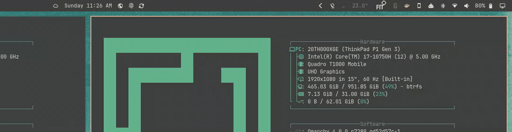
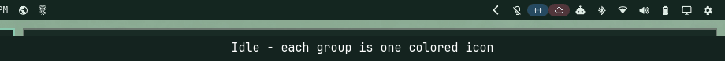

# Expanding Top Bar

If you've ever mashed your face up against the monitor
trying to tell Omarchy's tiny bar icons apart — is that bluetooth or audio,
who can say — congratulations, you're exactly who this plugin was built for.
Hover away.

An [Omarchy](https://omarchy.org/) shell bar plugin, cloned from the
built-in `omarchy.bar`, that grows thicker and scales up its widgets/icons
while the pointer is hovering over it, then animates back down when the
pointer leaves.



## What it changes vs. the stock bar

- The bar's thickness grows by ~10px on hover. It grows as an overlay on top
  of the windows below it, and tiled windows make room once, after the grow
  animation finishes (and move back once after it shrinks), so the animation
  itself stays smooth. Set `hoverShiftWindows` to `false` to never move
  windows at all.
- Every widget/icon in the bar scales up ~15% on hover.
- Every widget reserves room for its enlarged size, plus a small gap, so the
  larger icons never overlap their neighbors (the clock included).
- Optionally, the icon under the pointer magnifies further than the rest
  (`hoverIconBoost`).

All of it animates together over ~140ms. See
[How the animation works](#how-the-animation-works) for why it is built the
way it is.

No external dependencies — it only uses APIs already provided by
`omarchy-shell`.


(Set `hoverExpand` to `0` in `shell.json` if you'd rather the bar just sit
there — see [Configuring](#configuring).)


## Settings icon and icon groups

A gear icon sits at the right end of the bar. Click it for the basic hover
settings, and to switch on **icon groups**: related icons collapse into one
group icon, which you click to open. Groups are built by drag and drop in a
floating designer window, each with its own icon (a glyph or one of the bundled
SVGs) and background color. An icon that changes status can pop out of its
closed group for a few seconds. Everything is off until you enable it, and all
of it is stored under `bar` in `shell.json`. See [docs/UI-GUIDE.md](docs/UI-GUIDE.md)
for the keys and for how to work on the UI.




## Contributing and changing the graphics

Work happens on the `develop` branch; `master` is what users install.

- **Get the code and send changes back** (fork, branch, pull request, and what to
  do without write access): [CONTRIBUTING.md](CONTRIBUTING.md)
- **Change the UI by hand** (which file draws what, settings keys, restart and
  log workflow, common mistakes): [docs/UI-GUIDE.md](docs/UI-GUIDE.md)
- **Add or improve group icons** (where the SVGs go, how to register them, drawing
  rules): [icons/README.md](icons/README.md)
- **Test your change** (full manual checklist): [docs/TESTING.md](docs/TESTING.md)
- **Design background**: [proposal](docs/PROPOSAL.md) and
  [UI draft](docs/UI-DRAFT.md)
- **Open tasks**: [TODO.md](TODO.md)

## Install

```bash
omarchy plugin add https://github.com/GSkrt/omarchy-expanding-top-bar.git --enable
```

This clones the plugin into
`~/.config/omarchy/plugins/io.github.gskrt.expanding-top-bar/` and switches
your bar to it.

## Remove

To switch back to the stock bar and delete this plugin:

```bash
omarchy plugin enable omarchy.bar
omarchy plugin remove io.github.gskrt.expanding-top-bar
```

(Switch back to `omarchy.bar` first — removing the currently active bar
plugin out from under yourself isn't necessary, but doing it in this order
avoids a moment with no bar selected.)

## Configuring

Open `~/.config/omarchy/shell.json` and add (or edit) `hoverExpand` and
`hoverAnimationMs` under the top-level `bar` key. Both hot-reload on save —
no restart needed:

```json
{
  "bar": {
    "hoverExpand": 10,
    "hoverAnimationMs": 140
  }
}
```

If you installed with `omarchy plugin add --enable`, `shell.json` won't have
these keys yet — Omarchy never writes plugin defaults into your config file
(it's yours, no deep-merge), so the plugin just falls back to the defaults
shown above until you add them yourself.

**`hoverExpand`** (pixels, default `10`) is the one knob that controls the
whole grow effect. Everything else derives from it, so nothing drifts out of
sync:

- The bar grows thicker by exactly `hoverExpand` px on hover.
- Icons scale up by `1 + hoverExpand * 0.015` (10px → 1.15x, matching the default look).
- The gap opened up between widgets is `hoverExpand * hoverGapFactor` px
  (default factor `1.4`, so 10px → 14px). On top of that every widget reserves
  the extra width its enlarged icon takes, so the gap is only breathing room.

Set it to `0` to disable the grow effect entirely (the bar becomes static).
Larger values make a more dramatic hover effect; the growth is unbounded, so
very large values will look extreme.

**`hoverAnimationMs`** (milliseconds, default `140`) is how long the
grow/shrink transition takes when the pointer enters or leaves the bar.
Lower is snappier, higher is more of a slow reveal. Set it to `0` for an
instant, unanimated jump.

**`hoverIconBoost`** (number >= 1, default `1` = off) is an extra scale
multiplier applied only to the icon directly under the pointer, on top of the
bar-wide grow effect. For example `1.25` makes the hovered icon 25% larger than
its neighbours. The boost is full strength for a single icon (up to ~32px wide)
and tapers off for wider modules, so a group of icons can't swallow what's
next to it.

**`hoverGapFactor`** (number >= 0, default `1.4`) is how many pixels of gap
open up between widgets per pixel of `hoverExpand`. Lower it for a more compact
hovered bar (`0.4` with the default `hoverExpand` gives a 4px gap, `0` keeps the
idle spacing). Since every widget already reserves room for its enlarged size,
small values like `0.2` are enough.

**`hoverIconPadding`** (pixels, default `0` = off) opens up at least this much
extra room around the icon under the pointer so its neighbours step aside as it
magnifies. It also enlarges that icon's hover/click area. Wide modules (a group
of indicators, the clock) automatically get proportionally more.

**`hoverShiftWindows`** (boolean, default `true`) whether tiled windows make
room for the grown bar. `false` keeps the bar a pure overlay on top of them.

A fuller example with the tuned values used while developing this plugin:

```json
{
  "bar": {
    "hoverExpand": 15,
    "hoverAnimationMs": 200,
    "hoverIconBoost": 1.3,
    "hoverGapFactor": 0.2,
    "hoverIconPadding": 8,
    "hoverHighlight": 0.1,
    "hoverShiftWindows": true
  }
}
```

**`hoverHoldWhilePopup`** (boolean, default `true`) keeps the bar expanded
while a popup opened from it (audio, network, clock...) is showing, even if the
pointer has left the bar. It collapses once the popup is closed. `false`
collapses the bar as soon as the pointer leaves, as before.

**`hoverHighlight`** (0 to 1, default `0` = off) draws a soft rounded
highlight behind the icon under the pointer, and behind the icon whose popup is
open. It uses the bar's foreground color at this opacity, so it lightens a dark
theme and darkens a light one automatically. Modules that hold several icons
(workspaces, indicators, tray) get an icon-sized highlight that follows the
pointer along the module. `0.08`-`0.15` is subtle.

### Further tuning

The 1.5%-scale-per-px ratio (the fixed relationship between `hoverExpand` and
the icon scale, rather than the overall amount), the width a single icon may be
boosted at full strength (`boostRefExtent`), the 40ms hover-intent delay and the
easing curve are constants in `Bar.qml` — search for `hoverIconScale`,
`boostRefExtent`, `hoverIntent`, and the `Behavior on hoverProgress` block.

## How the animation works

Getting a hover effect that is both roomy and smooth took a few iterations. The
current design, and the reason for each piece:

**Scaling is not enough on its own.** A scaled item is only *drawn* bigger; the
layout still thinks it is its original size, so neighbours overlap it. Early
versions papered over that with a fixed gap, which was too loose for single
icons and too tight for wide groups like the indicators or the clock. Now,
while the bar is hovered, every widget reserves layout room equal to its
magnified size (`width × (scale − 1)`), and the hovered one reserves its extra
boost on top. Overlap is impossible by construction, whatever a widget's width,
and the gap is just a few pixels of breathing room.

**One progress value drives everything.** The bar thickness, the gap, every
icon's scale and every widget's reserved room are all derived from a single
`hoverProgress` that animates from 0 to 1 once per hover. Previously each had its
own animation; they started at slightly different moments and drifted apart,
which read as jitter. Only the hovered icon's extra boost animates on its own
(it has to follow the pointer from icon to icon).

**Hover intent.** Growing the hovered widget moves its neighbours, which can put
the stationary pointer over a different widget, which then grows, and so on.
A widget therefore only counts as hovered once the pointer has rested on it for
40ms, which stops the flip-flop at the border between two widgets. Reserved
widths are also rounded to whole pixels so text and icons stay crisp while the
layout moves.

**The compositor never sees the animation.** The bar is a layer-shell window,
and its reserved screen space normally follows its height. Animating the height
therefore made Hyprland re-tile every window below the bar on every frame, with
its own window animations running on top, and no amount of tuning on the QML
side could make that smooth. Instead:

- The bar window is always as tall as the fully expanded bar. It is transparent
  and only the drawn bar inside it grows, so the window is never resized.
- Input is limited to the drawn bar, so the empty headroom doesn't block clicks
  on the windows underneath.
- The reserved space changes only once, after the grow animation finishes, and
  changes back once after the shrink finishes. Windows below shift a single time,
  and Hyprland animates that one move itself. If the pointer only sweeps across
  the bar without resting, the animation never completes and the windows never
  move at all.
- `hoverShiftWindows: false` never reserves the extra space, making the bar a
  pure overlay.

---

Everything else below is unchanged from the original `omarchy.bar` this was
cloned from, and documents the bar engine itself.

---

This is the Quickshell implementation of the Omarchy status bar. It is
shipped as a first-party plugin of `omarchy-shell`, the long-running shell
host. The bar is mounted at startup and lives inside the shell for its
whole session.

- `manifest.json` declares the plugin (`kind: bar`) and points at `Bar.qml` as the entry point.
- `widgets/` holds simple first-party bar widgets with sibling manifests.
- The bar receives its config from the host shell as a `barConfig` property; the host loads it from `~/.config/omarchy/shell.json` (or `config/omarchy/shell.json` when the user has no file).
- `omarchy bar position` updates only the user shell.json file.

## Customizing

The bar config lives under the `bar:` key of `~/.config/omarchy/shell.json`. Once you customize anything via the bar gestures, `omarchy bar ...`, or by editing shell.json directly, your file is canonical — there is no deep-merge.

The bar is configured directly on the bar itself: drag empty bar space (or click-and-hold) to move the bar to another screen edge, double-left-click empty center-bar space to toggle transparency, and drag widgets to reorder them. The `omarchy bar position`, `omarchy bar transparent`, `omarchy bar move`, and `omarchy bar set` commands do the same from scripts. Enable or disable widgets with `omarchy plugin enable` and `omarchy plugin disable` (widget ids come from `omarchy plugin list`).

Example `shell.json` (bar subtree only shown):

```json
{
  "version": 1,
  "bar": {
    "position": "top",
    "transparent": false,
    "centerAnchor": "omarchy.clock",
    "layout": {
      "left": [
        { "id": "omarchy.menu" },
        { "id": "omarchy.spacer", "size": 12 },
        { "id": "omarchy.workspaces" }
      ],
      "center": [
        { "id": "omarchy.media" },
        { "id": "omarchy.clock", "format": "HH:mm" }
      ],
      "right": [
        { "id": "omarchy.audio" },
        { "id": "omarchy.power" }
      ]
    }
  }
}
```

`centerAnchor` pins one center module to the exact horizontal/vertical center and flanks others around it. Set to an empty string to disable anchoring (the center list is centered as a group).

## Module catalogue

### First-party interactive widgets

| Name | What it does | Interactions |
|---|---|---|
| `omarchy.menu` | Omarchy menu launcher | left = menu · right = terminal |
| `omarchy.workspaces` | Hyprland workspace switcher | left = focus workspace |
| `omarchy.clock` | Date/time label + popup with a month grid, ISO week numbers, and month stepping | left = popup · right = cycle label format · middle = timezone selector |
| `omarchy.media` | MPRIS now-playing — scrolling track + artist, cover-art popup | left = play/pause · middle = next · scroll = prev/next · right = popup |
| `omarchy.indicators` | Manual state indicators | left = indicator action |
| `omarchy.system-update` | Available update indicator | left = update |
| `omarchy.tray` | System tray | hover = reveal drawer · right on chevron = manage |
| `omarchy.weather` | Weather icon + popup with forecast | left = popup · right = full notification |
| `omarchy.microphone` | Mic icon + scroll volume | left = mute toggle · middle = audio panel · scroll = source volume |
| `omarchy.audio` | Volume icon + popup with master slider, output-device picker, per-app mixer | left = popup · right = mute · middle = popup · scroll = volume |
| `omarchy.network` | Wi-Fi/Ethernet icon + popup with Wi-Fi scan, signal, connect, DNS provider selection | left = popup |
| `omarchy.tailscale` | Tailscale status, connection switcher, machine browser, and copy actions | left = popup · right = toggle · middle = refresh |
| `omarchy.agents` | AI coding agent limits with pace, today, last week, and all-time model breakdown | left = panel · right = launch agent · middle = next subscription |
| `omarchy.power` | Battery/AC icon + popup with battery stats, power profiles, and system info | left = popup · right = toggle percentage |
| `omarchy.bluetooth` | Bluetooth icon + popup with device list, connect/disconnect, battery | left = popup · right = toggle radio |
| `omarchy.monitor` | Brightness and laptop display controls | left = popup |

The `omarchy.indicators` widget loads individual bar indicators from `indicators/`. Omit `items` (or set it to an empty array) to show all indicators in the default order, or set `items` to a subset such as `["Dnd", "Reminder", "NightLight"]`. Set `alwaysShow` to `true` to keep inactive indicators visible instead of revealing them only on hover. Multiple `omarchy.indicators` instances are allowed, so different sections can show different subsets.

## Orientation

All widgets work in `top`, `bottom`, `left`, and `right` positions. Popups anchor on the side opposite the bar edge, sliding into the workspace. Vertical bars use 28px width; widgets that show text fall back to compact icon-only forms (e.g. `media` hides its scrolling label).

## Custom user modules

The schema accepts arbitrary module ids that you provide. Set `type` to `command` for shell-driven output or `qml` for a custom QML widget. Both still go under `bar.layout.<section>` in `shell.json`.

Command module:

```json
{
  "version": 1,
  "bar": {
    "layout": {
      "right": [
        { "id": "omarchy.tray" },
        { "id": "vpn", "type": "command", "exec": "~/.config/omarchy/bar/scripts/vpn-status", "interval": 5, "tooltip": "VPN", "onClick": "nm-connection-editor" },
        { "id": "omarchy.audio" }
      ]
    }
  }
}
```

The command may print plain text or Waybar-style JSON, for example:

```json
{"text":"󰌆","tooltip":"Work VPN","class":"active"}
```

QML module:

```json
{
  "version": 1,
  "bar": {
    "layout": {
      "right": [
        { "id": "gpu", "type": "qml" },
        { "id": "omarchy.audio" }
      ]
    }
  }
}
```

Then create `~/.config/omarchy/bar/modules/gpu.qml`. If you want to store it elsewhere, add a `source` path.

Custom QML modules should be an `Item` with `implicitWidth` and `implicitHeight`. They may optionally define these properties, which the bar fills after loading:

```qml
import QtQuick

Item {
  property var bar
  property string moduleName
  property var settings

  implicitWidth: 28
  implicitHeight: bar ? bar.barSize : 26

  Text {
    anchors.centerIn: parent
    text: "GPU"
    color: bar ? bar.foreground : "white"
    font.family: bar ? bar.fontFamily : "monospace"
    font.pixelSize: 12
  }

  MouseArea {
    anchors.fill: parent
    onClicked: if (bar) bar.run("omarchy-launch-or-focus-tui btop")
  }
}
```

## Bar properties available to widgets

Widgets receive `bar` (the shell root), `moduleName` (string), and `settings` (object) injected at load time. The bar exposes:

- `bar.foreground`, `bar.background`, `bar.urgent` — theme colors (live-updated)
- `bar.fontFamily` — current monospace family
- `bar.position` — `"top" | "bottom" | "left" | "right"`
- `bar.vertical` — boolean shortcut
- `bar.barSize` — 26 horizontal / 28 vertical at rest (grows on hover in this fork)
- `bar.run(command)` — fire-and-forget bash exec
- `bar.shellQuote(value)` — safe shell-quote a string
- `bar.showTooltip(target, text)` / `bar.hideTooltip(target)` — shared tooltip popup
- `bar.requestPopout(owner)` / `bar.releasePopout(owner)` — one-popup-at-a-time coordinator

First-party bar widgets are manifest-backed just like third-party widgets.
Simple widgets carry sibling manifests such as `widgets/Workspaces.manifest.json`;
richer popup plugins live in feature directories such as `../panels/audio/`,
`../panels/network/`, and `../agents/`; and feature plugins such as
`omarchy.menu` and `omarchy.media` declare their bar-widget entry points in their own
`manifest.json`. Bar layout ids are namespaced, e.g. `omarchy.audio`,
`omarchy.network`, and `omarchy.clock`. Older UpperCamelCase ids such as
`AudioPanel` and `Clock` are migrated forward; new configs should use the
namespaced ids.

Third-party widgets ship as separate plugins under
`~/.config/omarchy/plugins/<plugin-id>/` with their own `manifest.json`
declaring `kinds: ["bar-widget"]` and a `barWidget` entry point. Rescan,
enable, and place third-party plugins with `omarchy-shell shell
rescanPlugins`, `omarchy plugin enable`, and `omarchy bar move`.

